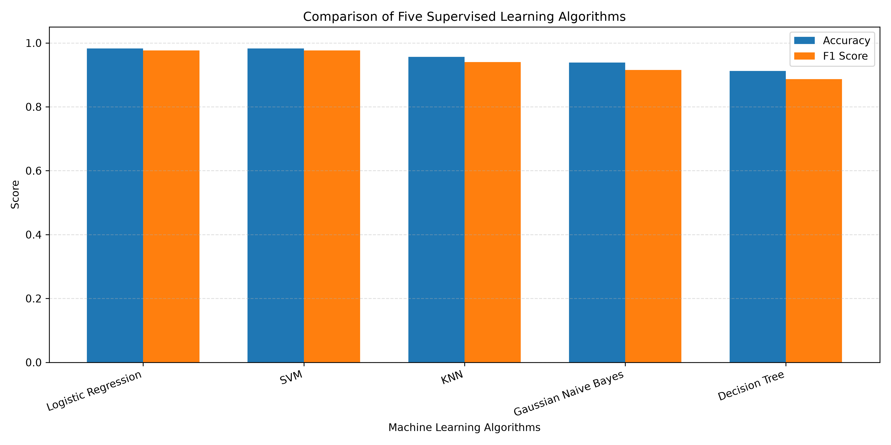

# Comparative Analysis of Five Supervised Learning Algorithms

## Project Overview

This project compares five supervised machine learning classification algorithms using the Breast Cancer Wisconsin Diagnostic dataset.

The objective is to understand how different algorithm families perform when trained and evaluated on the same dataset.

The project was developed as part of the Machine Learning internship at Valentius Kryptix.

Five algorithms were implemented using scikit-learn:

1. Logistic Regression
2. Decision Tree
3. K-Nearest Neighbors (KNN)
4. Support Vector Machine (SVM)
5. Gaussian Naive Bayes

All models were trained and evaluated using the same training and testing samples.

## Dataset Description

The Breast Cancer Wisconsin Diagnostic dataset contains 569 samples and 30 numerical input features.

The features describe characteristics of cell nuclei, including radius, texture, perimeter, area, smoothness, and other measurements.

The target variable contains two classes:

- 0: Malignant
- 1: Benign

### Dataset Distribution

| Class | Total Samples |
|---|---:|
| Malignant | 212 |
| Benign | 357 |
| Total | 569 |

The dataset was divided into 80% training data and 20% testing data.

| Dataset | Samples |
|---|---:|
| Training | 455 |
| Testing | 114 |

A stratified split was used to preserve approximately the same class proportions in both sets.

## Data Preprocessing

The following preprocessing steps were applied:

### Missing Value Handling

Missing values were checked using Pandas.

Although the dataset contained no missing values, a SimpleImputer with median imputation was included to handle missing numerical values consistently.

The imputer was fitted on the training data only, preventing data leakage.

### Feature Standardization

StandardScaler was used to standardize features for algorithms sensitive to feature scales.

The standardization formula is:

X_scaled = (X − μ) / σ

Where:

- X represents the original feature value.
- μ represents the training feature mean.
- σ represents the training feature standard deviation.

The scaler was fitted using the training dataset and then applied to both the training and testing datasets.

### Preprocessing Used by Each Model

| Algorithm | Preprocessing |
|---|---|
| Logistic Regression | Median imputation + StandardScaler |
| Decision Tree | Median imputation |
| KNN | Median imputation + StandardScaler |
| SVM | Median imputation + StandardScaler |
| Gaussian Naive Bayes | Median imputation |

All five algorithms used the same training and testing records.

The distinction in scaling reflects the requirements of the different algorithms.

No categorical encoding was necessary because all 30 input features were numerical.

## Algorithms Implemented

### 1. Logistic Regression

Logistic Regression is a supervised learning classification algorithm that estimates class probabilities using a sigmoid function.

It learns a linear decision boundary between classes.

The model was trained on standardized features.

### 2. Decision Tree

Decision Tree classifies samples using a sequence of feature-based decision rules.

It can learn nonlinear relationships and does not require feature standardization.

The model used the default tree-growing settings with a fixed random state.

### 3. K-Nearest Neighbors

KNN classifies samples based on the labels of nearby training examples.

For this experiment, the model used five neighbors.

Standardized features were used because KNN relies on distance calculations.

### 4. Support Vector Machine

SVM finds a separating decision boundary between classes.

The RBF kernel was used to allow nonlinear decision boundaries.

The model was trained using standardized features.

### 5. Gaussian Naive Bayes

Gaussian Naive Bayes is a probabilistic classifier based on Bayes' theorem.

It assumes that numerical features follow Gaussian distributions within each class and are conditionally independent given the class.

The model was trained using imputed, unscaled features.

## Model Evaluation

All five algorithms were evaluated on the same 114 testing samples.

Four evaluation metrics were used.

**Accuracy:** Measures the proportion of correctly classified samples.

**Precision:** Measures the proportion of predicted malignant samples that were actually malignant.

**Recall:** Measures the proportion of actual malignant samples correctly identified.

**F1-score:** Calculates the harmonic mean of precision and recall.

For precision, recall, and F1-score, malignant samples (class 0) were treated as the positive class.

## Experimental Results

The following table presents the results obtained from the five supervised learning algorithms.

| Algorithm | Accuracy | Precision | Recall | F1-score |
|---|---:|---:|---:|---:|
| Logistic Regression | 0.982456 | 0.976190 | 0.976190 | 0.976190 |
| SVM | 0.982456 | 0.976190 | 0.976190 | 0.976190 |
| KNN | 0.956140 | 0.951220 | 0.928571 | 0.939759 |
| Gaussian Naive Bayes | 0.938596 | 0.926829 | 0.904762 | 0.915663 |
| Decision Tree | 0.912281 | 0.847826 | 0.928571 | 0.886364 |

The models are ordered by F1-score. Logistic Regression and SVM are tied for the highest score.

## Model Performance Visualization

The following chart compares the accuracy and F1-score of all five algorithms.



The detailed numerical results are available in `results/model_comparison.csv`.

## Results Analysis

### Best-Performing Models: Logistic Regression and SVM

Logistic Regression and SVM achieved the highest accuracy of approximately 98.25% and the highest F1-score of approximately 97.62%.

Both models correctly classified 112 of the 114 testing samples.

Their strong performance suggests that the dataset contains patterns that these models can separate effectively.

Logistic Regression uses a linear decision boundary, while SVM with the RBF kernel can represent more complex nonlinear relationships.

The identical results indicate that both approaches were effective for this particular train/test split.

However, the matching performance does not prove that both models learned identical decision boundaries.

### KNN Performance

KNN achieved an accuracy of approximately 95.61%.

Standardization helped make distance calculations more balanced across features with different numerical ranges.

However, KNN performance depends on the selected number of neighbors and the distances between samples.

Because the dataset contains 30 features, distance-based classification can be more challenging than in low-dimensional datasets.

### Gaussian Naive Bayes Performance

Gaussian Naive Bayes achieved an accuracy of approximately 93.86%.

The model performed reasonably well but produced more classification errors than Logistic Regression, SVM, and KNN.

One possible explanation is that several measurements in the dataset are strongly related.

Gaussian Naive Bayes assumes conditional independence between features, which may not accurately represent these relationships.

### Lowest-Performing Model: Decision Tree

The Decision Tree achieved the lowest testing accuracy of 91.23% and the lowest F1-score of 88.64% among the five supervised learning algorithms.

To investigate its performance, I compared the model's training accuracy with its testing accuracy.

| Evaluation | Accuracy |
|---|---:|
| Training Accuracy | 100.00% |
| Testing Accuracy | 91.23% |
| Generalization Gap | 8.77 percentage points |

The Decision Tree correctly classified all 455 training samples but made 10 incorrect predictions on the 114 testing samples.

This difference provides evidence consistent with overfitting.

The model was trained using the default DecisionTreeClassifier configuration, without restricting its maximum depth.

As a result, the tree may have learned highly specific rules that fit the training data but generalized less effectively to unseen samples.

This helps explain why the Decision Tree performed worse than Logistic Regression, SVM, KNN, and Gaussian Naive Bayes on the selected test split.

Applying techniques such as maximum depth restriction, minimum samples per leaf, or cost-complexity pruning could potentially improve generalization.

However, additional experiments would be required to determine whether these techniques improve performance on this dataset.

## Key Findings

The experiment demonstrated that different supervised learning algorithms can produce noticeably different results even when trained on the same dataset.

Logistic Regression and SVM performed best on this particular test split.

KNN achieved strong results after feature standardization, while Gaussian Naive Bayes provided a simpler probabilistic approach.

Decision Tree had the lowest performance, suggesting that additional tuning or pruning might improve its ability to generalize.

These results highlight the importance of comparing algorithms rather than assuming that a more complex model will always perform better.

## Project Structure

```text
Supervised-Learning-Algorithm-Comparison/
├── data/
│   └── breast_cancer.csv
├── results/
│   ├── model_comparison.csv
│   └── model_comparison.png
├── main.py
├── README.md
├── requirements.txt
└── .gitignore
```

## Installation and Execution

### 1. Clone the Repository

```bash
git clone https://github.com/psarya/Supervised-Learning-Algorithm-Comparison
```

### 2. Navigate to the Project Directory

```bash
cd Supervised-Learning-Algorithm-Comparison
```

### 3. Install Dependencies

```bash
pip install -r requirements.txt
```

### 4. Run the Experiment

```bash
python main.py
```

The script loads the dataset, performs preprocessing, trains five classification algorithms, evaluates their performance, and generates comparison results.

## Technologies Used

- Python
- NumPy
- Pandas
- Matplotlib
- Scikit-learn

## Conclusion

This project compared five supervised learning classification algorithms on the Breast Cancer Wisconsin Diagnostic dataset.

Logistic Regression and SVM achieved the best performance on the selected test set, while Decision Tree produced the lowest scores.

The experiment demonstrated the importance of appropriate preprocessing, consistent evaluation metrics, and comparing multiple machine learning approaches using identical data splits.

The results also showed that model complexity does not automatically guarantee better predictive performance.

This project was completed for educational purposes and is not intended for clinical diagnosis.